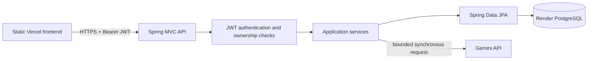

# Architecture overview

## Application flow

- Registration/login stores a BCrypt password hash and returns a short-lived signed access token.
- The JWT subject is the server-created user ID; clients cannot choose the owner of a submission.
- Controllers pass the authenticated user ID to services. Submission/version reads and writes are scoped to that owner.
- Submission history uses page/size limits and returns metadata only. Source and analysis are returned only from owner-checked review endpoints.
- Code analysis runs outside a database transaction, uses a finite HTTP timeout and capped prompt/output size, then persists its result.
- Local development uses MySQL migrations in `db/migration`; production uses PostgreSQL migrations in `db/migration/postgresql`.

## Production controls

- Stateless bearer authentication; CSRF is disabled because authentication is not cookie-based.
- CORS allows only configured origins. Browser credentials are not enabled.
- Rate limiting is process-local and intended as a low-cost baseline, not a substitute for edge protection across multiple instances.
- Actuator exposes health/info only. Health details are hidden.
- `ddl-auto=validate`; Flyway owns schema creation and evolution.
